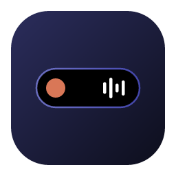
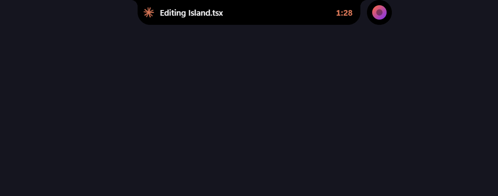
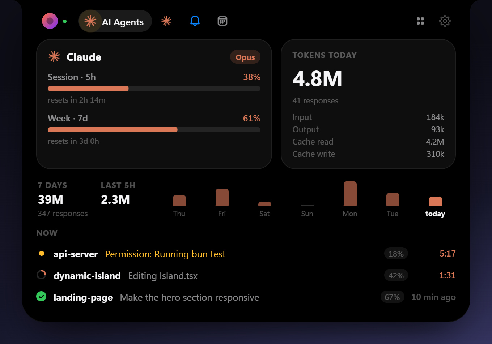
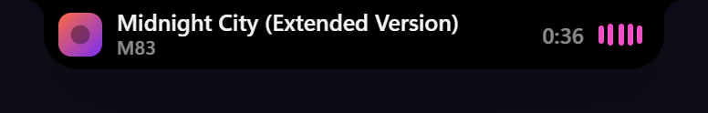
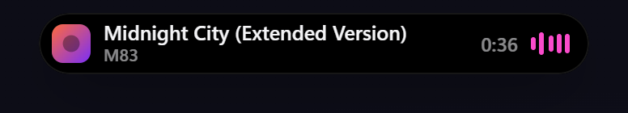
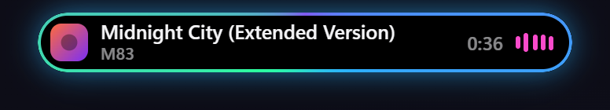
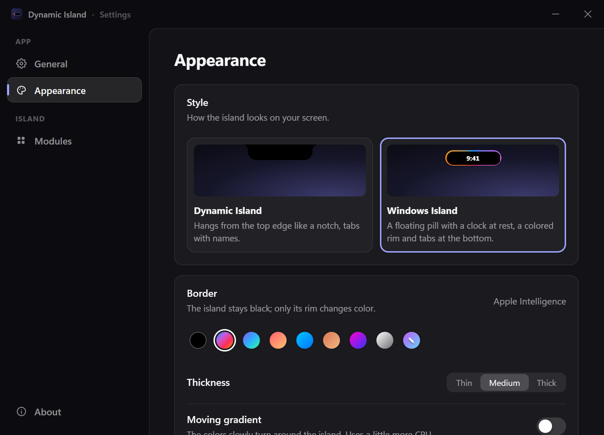

<div align="center">



# Notch Us
### The Intelligent Dynamic Island & AI Command Center for Windows

An ultra-fluid, macOS/iOS-inspired Dynamic Island that floats at the top of your Windows desktop. Designed for developers and power users, it puts your AI coding agents, media, notifications, and productivity telemetry right in your peripheral vision—vanishing seamlessly when you need focus.

[](https://github.com/samjoel147/notch-us/releases/latest)
[](LICENSE)
[](https://github.com/samjoel147/notch-us)
[](https://tauri.app)

[**Download Latest Release (Free)**](https://github.com/samjoel147/notch-us/releases/latest) · [**Report Bug**](https://github.com/samjoel147/notch-us/issues) · [**Request Feature**](https://github.com/samjoel147/notch-us/issues)

<br />



</div>

---

## ⚡ Highlights

- 🤖 **Universal AI Agent Command Deck** — Live real-time status of your active **Antigravity**, **Claude Code**, and **Codex** agents. Approve shell commands, file edits, and web requests directly from the notch without leaving your workspace.
- 💬 **Global AI Vision Modal (`Ctrl+Alt+Space`)** — Instant floating AI prompt from anywhere on your desktop. Attaches screen context or active window snapshots without needing manual screenshots or copy-pasting.
- 🔍 **Global Screen OCR Search (`Ctrl+Alt+F`)** — Browser-style Ctrl+F across all active monitors. Detects and highlights text inside video streams, images, and non-selectable UI with sub-second accuracy.
- 📊 **Dynamic Hardware Monitor** — Real-time telemetry for CPU (with thread counts), RAM, discrete GPU utilization, and bidirectional network throughput paired with micro-sparklines.
- 🍅 **VisionOS Pomodoro Hub** — Isolated multi-phase state management (`Focus`, `Short Break`, `Long Break`), 4-cycle progress tracking, and organic ambient light glow.
- 💧 **Smart Hydration Engine** — Daily water intake tracking with realistic liquid vessel physics and smart scheduling reminders.
- 🎵 **Full-Spectrum Media & PiP** — Works across Spotify, Apple Music, and browsers. Features live audio visualizers, dynamic artwork color palette adaptation, and detached YouTube Picture-in-Picture.
- 📋 **Visual Clipboard Hub** — Persistent history for snippets, files, and screenshots with built-in image zoom preview and one-click HEX/RGB/HSL color chip conversion.
- 📁 **Elastic File Shelf** — Drop files and folders onto the notch to park them by reference; drag them out into any desktop app via native Windows OLE drag-and-drop.
- 🪶 **Zero Distraction Architecture** — Automatically suppresses during fullscreen games and presentations, expands organically on hover, and smoothly collapses into an idle pill or screen-edge notch.

---

## 🤖 The AI Co-Pilot Experience

<p align="center">
  
</p>

### 1. Live Session Telemetry
- Inspect active turns, running tool commands, token consumption rates, and reset countdowns in real time.
- Differentiates simultaneous sessions across separate projects with automatic prompt-header matching.

### 2. In-Notch Permission Approvals
- When an AI agent requests terminal execution, file overwrite, or web access:
  - The island expands with full security context (target command, path diff, or origin URL).
  - Authorize with **Allow**, enforce permanent approval rules with **Always Allow**, or **Deny** with a single keystroke or click.

### 3. Screen Vision & Headless Ask
- Invoke with <kbd>Ctrl</kbd> + <kbd>Alt</kbd> + <kbd>Space</kbd>.
- Streams responses asynchronously and pings you upon completion with an ambient notch notification.

---

## 🎨 Make It Yours

Choose between two distinct architectural form factors in **Settings → Appearance**:

1. **Dynamic Island** (Default): A flush, screen-edge black notch engineered to merge into your display bezel.
2. **Windows Island**: A floating glass pill featuring customizable luminous reactive rims:
   - Presets: *Apple Intelligence*, *Aurora*, *Claude*, *Neon*, *Sunset*, *Ocean*, or custom duo-color gradients.
   - Real-time reactive audio glow and liquid glass top sheen.

<table align="center">
  <tr>
    <td align="center"><br /><sub><b>Dynamic Island</b> (Flush Notch)</sub></td>
    <td align="center"><br /><sub><b>Windows Island</b> (Subtle Hairline)</sub></td>
  </tr>
  <tr>
    <td align="center"><br /><sub><b>Windows Island</b> (Aurora Glow)</sub></td>
    <td align="center"><br /><sub><b>Customization Suite</b></sub></td>
  </tr>
</table>

---

## 📦 Built-In Modules

| Module | Core Capabilities |
| :--- | :--- |
| **System Monitor** | CPU load & active thread count, RAM consumption, discrete GPU rendering metrics, network IO sparklines. |
| **Pomodoro Timer** | VisionOS segmented phase switcher, persistent pause states per mode, luminous progress ring, 4-stage round beads. |
| **Hydration Vessel** | Customizable daily intake goal, quick-log volume presets (250ml–750ml), dynamic liquid surface animation. |
| **Music & YouTube** | Windows SMTC integration, audio spectrum visualizer, synced background video, floating draggable PiP window. |
| **Clipboard Manager** | Multi-type clipboard history (text, images, files), instant color swatch conversion (HEX / RGB / HSL), image magnification. |
| **File Shelf** | Temporary drag-and-drop file parking lot with native Windows OLE drag-out support. |
| **Notifications** | Windows Action Center mirroring for WhatsApp, Discord, Slack, Teams, and email clients. |
| **GitHub Tracker** | Live monitoring of repositories, unread issue badges, and quick-access issue details. |
| **Calendar & Clock** | Month calendar overview, week calculation, and countdown intervals to scheduled dates. |

---

## 🛠️ Installation & Setup

### Binary Release (Recommended)
1. Download `Dynamic.Island_<version>_x64-setup.exe` from the [Latest Release](https://github.com/samjoel147/notch-us/releases/latest).
2. Run the installer (installs safely for current user without requiring Administrator elevation).
3. Requires **Windows 10 (20H2+) or Windows 11**.

### Building From Source
Ensure you have [Bun](https://bun.sh) and [Rust](https://rustup.rs) (1.98+) installed.

```bash
# Clone the repository
git clone https://github.com/samjoel147/notch-us.git
cd notch-us

# Install frontend dependencies
bun install

# Run the live desktop app with hot reload
bun run app:dev

# Build production binaries and setup installers
bun run app:build
```

---

## 🔌 Local Automation API

Notch Us exposes a local REST API on `http://127.0.0.1:5199` for shell scripts, PowerShell automation, and third-party apps:

```bash
# Dispatch an instant ambient notification
curl -X POST http://127.0.0.1:5199/notify \
  -H "Content-Type: application/json" \
  -d '{
    "title": "Build Completed",
    "subtitle": "All 242 tests passing",
    "icon": "check",
    "color": "#30D158"
  }'
```

---

## 👨‍💻 Author

**Sam Joel**  
GitHub: [@samjoel147](https://github.com/samjoel147)  
Project Repository: [https://github.com/samjoel147/notch-us](https://github.com/samjoel147/notch-us)

---

## 📄 License

This project is licensed under the **GNU General Public License v3.0 or later** - see the [LICENSE](LICENSE) file for details.
